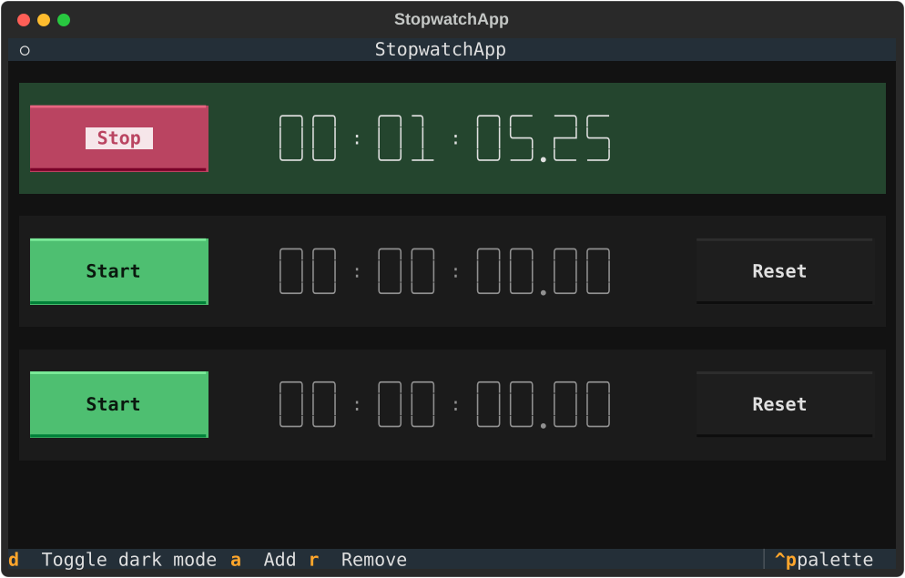
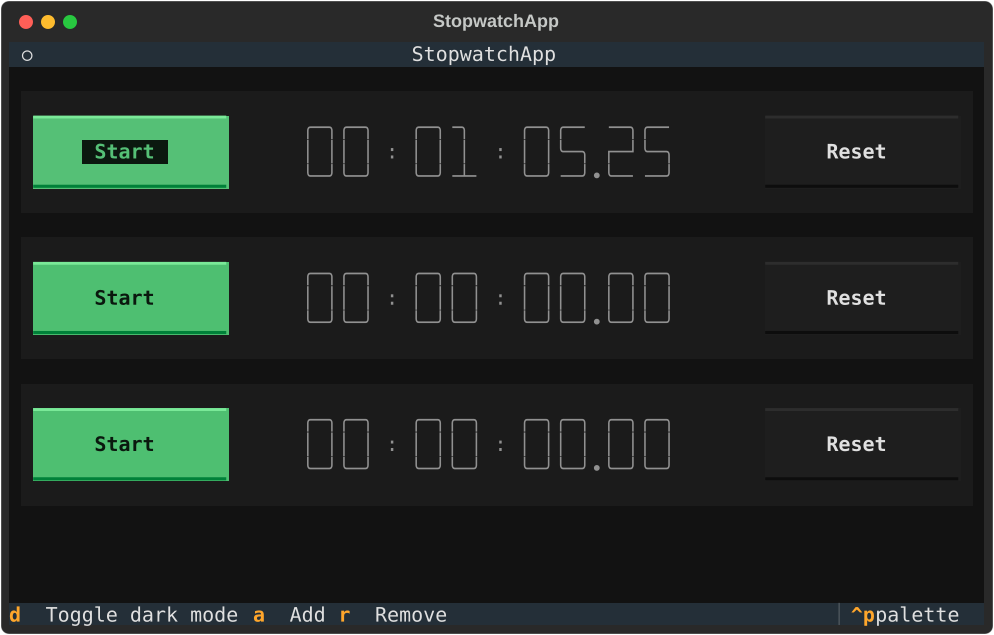

# 02 — The stopwatch

> **Runtime: hermetic.** Textual runs headless; nothing is bound and no real
> terminal is drawn on.

Each row is one stopwatch, and each runs on its own. **Start** runs it and
turns the row green. **Stop** freezes it. **Start** again resumes from the
frozen time; time spent stopped is not counted. **Reset** zeroes it, and is
hidden while the stopwatch runs, so a stray click cannot wipe a running time.





Both pictures are drawn by `tests/test_stopwatch.py`, from the run whose
assertions check what they show: the elapsed time, the time holding still once
stopped, which buttons are showing. They are recorded and never compared. The
assertions are the regression check; a picture is what the screen looked like
when they passed. The test's clock only moves when the test moves it, so the
time in the picture is the same on every run.

## Keys

| Key | Does |
| --- | --- |
| `d` | Toggle dark mode |
| `a` | Add a stopwatch at the bottom |
| `r` | Remove the bottom stopwatch |

That table is the app's own key bindings:

```python
>>> from stopwatch import StopwatchApp
>>> [(key, description) for key, _action, description in StopwatchApp.BINDINGS]
[('d', 'Toggle dark mode'), ('a', 'Add'), ('r', 'Remove')]

```
