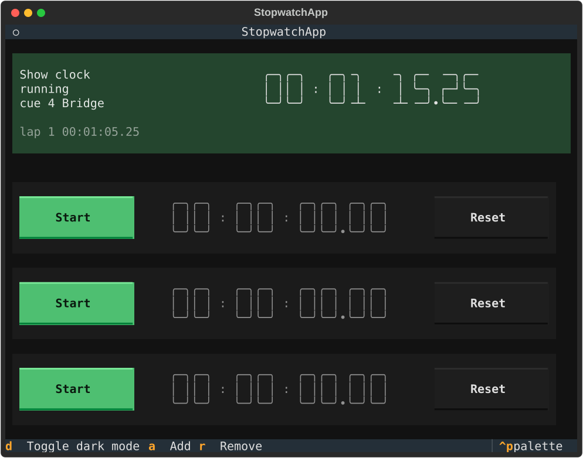

# 03 — The show clock

> **Runtime: hermetic.** No port and no browser: the clock and the view
> reading it both run in this process, and the view is driven headless.

`showstopper serve` keeps one clock beyond the rows of stopwatches: the show
clock, which the performing family's hub drives. ShowRunner fires a cue, and
for every member the cue's `family` block names, it delivers that member's
part. ShowStopper's part is a clock action, and it arrives on the served port
itself, beside the page:

| Route | Body | Answers |
| --- | --- | --- |
| `POST /family/cue` | `{"cue": {"number", "name", "fired_at"}, "action": {"clock": "start"}}` | `200 {"ok": true, "state": {...}}` |
| | anything it does not understand | `422 {"ok": false, "error": "..."}` |
| `GET /family/state` | | `200 {"member": "showstopper", "cue": {...} or null, "state": {...}}` |

Those are the routes the served port carries, read off the routes themselves:

```python
>>> import family
>>> [(route.method, route.path) for route in family.routes(family.Member())]
[('POST', '/family/cue'), ('GET', '/family/state')]

```

## What a cue does

There is one clock per served instance. textual-serve starts an app process
for each connection, so the clock is kept in the `serve` process, and every
view reads it from `GET /family/state` rather than keeping one of its own. Here
the clock's time only moves when the page moves it:

```python
>>> now = [100.0]
>>> member = family.Member(family.Clock(now=lambda: now[0]))
>>> member.snapshot()
{'member': 'showstopper', 'cue': None, 'state': {'running': False, 'elapsed': 0.0, 'laps': []}}
>>> def cue(number, verb):
...     return {"cue": {"number": number, "name": "Second tune",
...                     "fired_at": "2026-10-10T20:00:00+00:00"},
...             "action": {"clock": verb}}
>>> member.receive(cue("3", "start"))
(200, {'ok': True, 'state': {'running': True, 'elapsed': 0.0, 'laps': []}})
>>> now[0] += 65.25
>>> member.receive(cue("4", "lap"))
(200, {'ok': True, 'state': {'running': True, 'elapsed': 65.25, 'laps': [65.25]}})
>>> now[0] += 10
>>> member.receive(cue("5", "stop"))
(200, {'ok': True, 'state': {'running': False, 'elapsed': 75.25, 'laps': [65.25]}})
>>> member.snapshot()["cue"]["number"]
'5'

```

| Action | Does |
| --- | --- |
| `start` | Runs the clock. Already running, nothing changes |
| `stop` | Holds it. Time spent stopped is not counted when it starts again |
| `lap` | Records the time on the clock, running or not |
| `reset` | A fresh clock: stopped, at zero, with no laps |

```python
>>> member.receive(cue("6", "reset"))
(200, {'ok': True, 'state': {'running': False, 'elapsed': 0.0, 'laps': []}})

```

Anything else is refused with a reason, and a refused cue changes nothing, the
record of the last cue included:

```python
>>> member.receive(cue("7", "rewind"))
(422, {'ok': False, 'error': "the clock can start, stop, reset, lap; it cannot 'rewind'"})
>>> member.snapshot()["cue"]["number"]
'6'

```

## What a view shows

The show clock sits above the stopwatches, and it is drawn only when the app
is served for the family: `showstopper serve` starts each view with
`--family <its own address>`. The three rows below it are that view's own, and
a cue leaves them alone. Between reads the view counts on from the last one,
so the digits run smoothly, and it reads again several times a second.



The picture is drawn by `tests/test_stopwatch.py`, from the run whose
assertions check what it shows: the time, the cue that last moved the clock,
the lap, and the rows below it still stopped. `tests/test_family.py` holds the
same routes to account over HTTP, against a real `showstopper serve` with two
views connected to it the way a browser connects.
